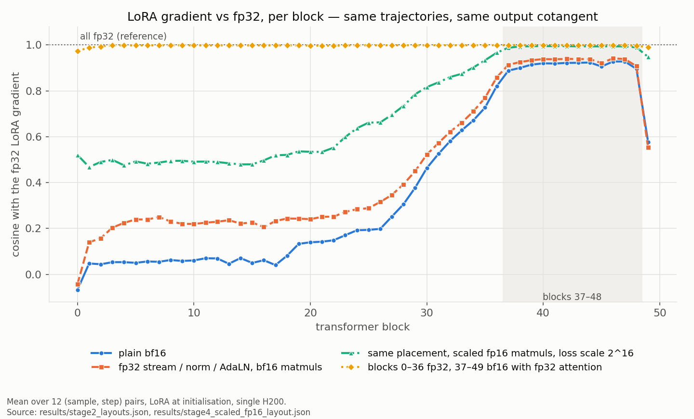
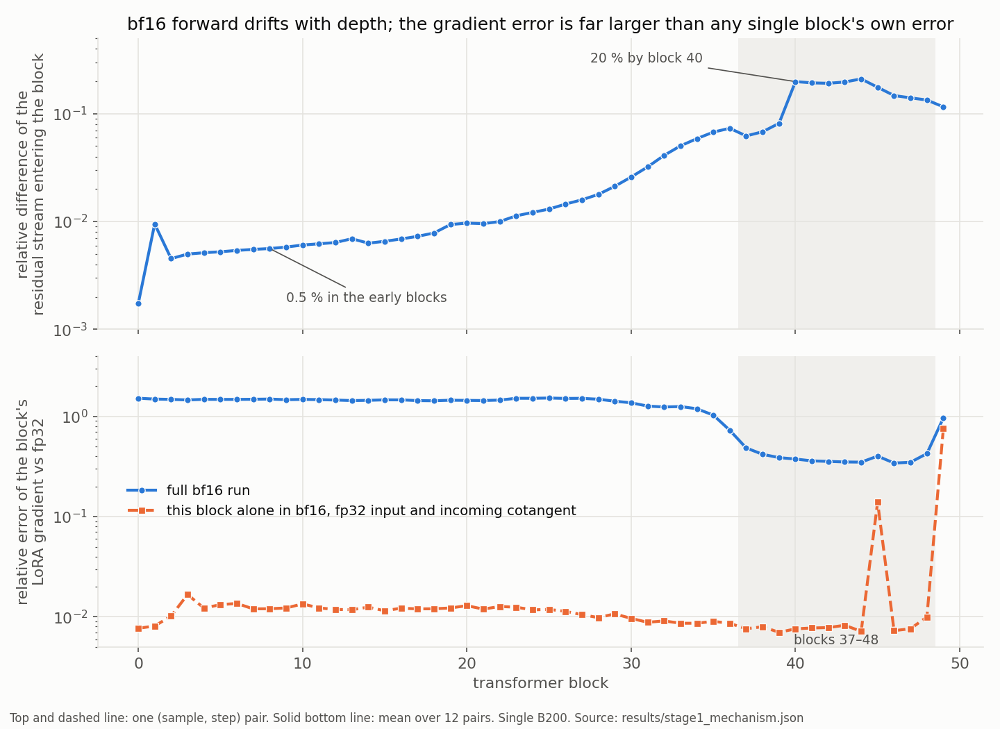
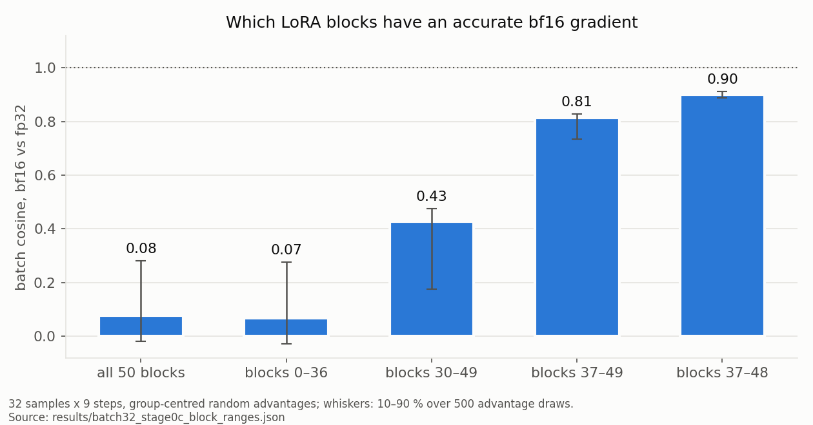
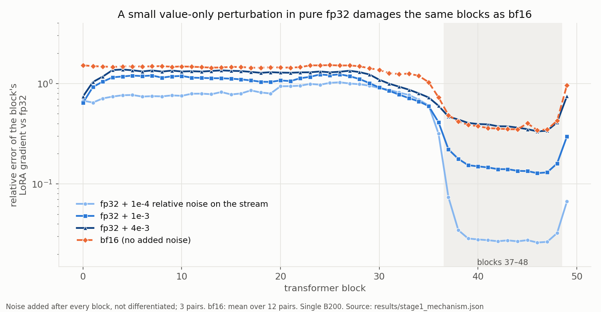

# MiniMax-H3 bf16 vs fp32 LoRA-gradient harness

Measurement code behind the numbers posted in Tencent-Hunyuan/UniRL#678. It is a verification harness, not part of
UniRL, and is not meant to be merged. It still carries the layout of my own runner (Modal).

Base: UniRL `main` at `4af23a2`. The H3, SDE and Flow-GRPO files are unchanged up to `371d814`.
Runtime: PyTorch 2.13.0+cu130, diffusers 0.40.0, peft 0.21.2.

## Layout

Copy `modal_runs/` from this repository into the root of a UniRL checkout; the runners assume exactly this placement.

| File | What it is |
| --- | --- |
| `modal_runs/h3_grad_precision.py` | Shared helpers: per-child dtype cast, bf16 rollout, per-(sample, step) gradients with a recorded / fixed output cotangent, Gram-based comparison, shard + merge, state fingerprints. `--partest` is its CPU self-test. |
| `modal_runs/h3_grad_l1_modal.py` | Runner for the 32-sample batch (`download`, `embed`, `par`: four GPU shards + CPU merge) and the CPU analyses on the stored gradients (`stage0`, `stage0b`, `stage0c`, `stage0d`). |
| `modal_runs/h3_grad_l0_modal.py` | CPU runner for `h3_grad_precision.py --partest`. |
| `modal_runs/h3_rootcause/rc.py` | The mechanism harness: functional copies of the block and `norm_out` forwards with a dtype per operation, plus `stage1` … `stage4` and a CPU self-test (`python rc.py`). |
| `modal_runs/h3_rootcause/rc_modal.py` | GPU runner for `rc.py` (`main` = stage 1, `s2`, `s3`, `s4`). |
| `modal_runs/h3_rootcause/cpu_modal.py` | CPU runner for the `rc.py` self-test. |
| `modal_runs/h3_rootcause/inspect_src.py` | Prints the diffusers / peft / torch source that `rc.py` mirrors. |
| `modal_runs/h3_rootcause/results/` | The JSON reports the tables were read from. |
| `modal_runs/h3_rootcause/make_figures.py`, `figures_modal.py` | Draw the figures below from `results/` (matplotlib only; `figures_modal.py` is a CPU runner). |
| `modal_runs/h3_rootcause/figures/` | The rendered figures. |

## Figures

Redraw with `python modal_runs/h3_rootcause/make_figures.py --results modal_runs/h3_rootcause/results --out modal_runs/h3_rootcause/figures`.

Per-block cosine against the fp32 gradient for four layouts (stages 2 and 4, H200, 12 (sample, step) pairs):



bf16 forward drift of the residual stream, and the per-block gradient error of the whole bf16 model against one block alone in bf16 (stage 1, B200):



Batch cosine by LoRA block range, 32 samples x 9 steps, whiskers = 10–90 % over 500 advantage draws:



Pure fp32 with a value-only relative perturbation on the stream, against bf16 (stage 1):



## Design in short

- Trajectories are rolled out once with the stock bf16 model. Every gradient is of `<c, model output>` where `c` is
  the bf16 run's `d(-logp)/d(output)`, so two arms differ only in the model's forward + backward compute precision.
- No module is cast for the blocks. `rc.fblock` / `rc.fhead` recompute the vendor forwards with a dtype per
  operation (`stream`, `norm`, `modtab`, `modar`, `qkv`, `qknorm`, `core`, `out`, `ff1`, `ff2`, optional `swiglu`,
  `out_scale`, `ff2_scale`), casting the stored weights on the fly. Only the stem (`context_embedder`,
  `token_refiner`) is module-cast; its weights are bf16-representable so that is lossless.
- LoRA is injected with `torch.manual_seed(0)` and stays at `lora_B == 0`; LoRA masters are fp32.
- The terminal step (`sigma_next == 0`) is excluded from per-sample gradients in the 32-sample batch.

## Which entry produced which table

| Posted result | Entry | Report |
| --- | --- | --- |
| 32 samples x 9 steps, all-block cosine, per-block, error structure | `h3_grad_l1_modal.py::par` | `results/batch32_report.json` |
| Cosine by block range (0–36, 37–48, …) | `::stage0c` | `results/batch32_stage0c_block_ranges.json` |
| Pairwise sample statistics, expected-gradient estimate | `::stage0`, `::stage0b` | `results/batch32_stage0*.json` |
| First Adam step (sign agreement) | `::stage0d` | `results/batch32_stage0d_adam_first_step.json` |
| Factor split, boundary reset, per-block local VJP, noise baseline, partial-precision schemes | `rc_modal.py` (`main`) → `rc.stage1` | `results/stage1_mechanism.json` |
| Deep-only layouts, frozen timings, fp32 rollout consistency, 10-step graph | `rc_modal.py::s2` → `rc.stage2` | `results/stage2_layouts.json` |
| fp16 overflow / underflow localisation | `rc_modal.py::s3` → `rc.stage3_fp16` | `results/stage3_fp16_overflow.json` |
| Scaled fp16 layout (`/ 64`, `/ 256`, loss scale 2^16) | `rc_modal.py::s4` → `rc.stage4_scaled_fp16` | `results/stage4_scaled_fp16_layout.json` |

Stage 1 and the 32-sample batch ran on B200; stages 2–4 on H200. Timings are only comparable within one report.

## Running it

Self-tests need no weights and run on CPU in a few minutes:

```bash
modal run modal_runs/h3_rootcause/cpu_modal.py --script rc.py --flags "--layers 8"
modal run modal_runs/h3_grad_l0_modal.py --flags "--partest --layers 12 --prompts 2 --group 4 --steps 4"
```

GPU entries expect a Modal volume mounted at `/cache` with the H3 checkpoint at `/cache/models/minimax-h3`
(`h3_grad_l1_modal.py::download`) and text embeddings at `/cache/h3_grad/embeds_2.pt` (`h3_grad_l1_modal.py::embed`,
which never overwrites an existing file and reports how a fresh encode compares with it).

```bash
modal run modal_runs/h3_rootcause/rc_modal.py          # stage 1, one GPU with 180 GB
modal run modal_runs/h3_rootcause/rc_modal.py::s4      # scaled fp16 layout, one GPU with 141 GB or more
```

### Hardware

Single GPU only: the whole transformer sits on one device (66 GB of bf16 weights). Stages 2–4 peaked at 78–94 GB;
stage 1 and `h3_grad_l1_modal.py::par` also run the stock model cast to fp32 and peaked at 131 GB. Nothing here
spreads the model over several GPUs.

### Without Modal, or with the model on several GPUs

- `rc.py` and `h3_grad_precision.py` have no Modal dependency. They need PyTorch, diffusers, peft, UniRL importable,
  and a stage built by `h3_grad_precision.make_stage(transformer, device)`. The three `*_modal.py` files only build
  the image, mount the volume, load the checkpoint, inject LoRA and call `rc.stage1` … `rc.stage4_scaled_fp16` or
  `h3_grad_precision.shard_payload`; `rc_modal.py::stage4` is the shortest example of that sequence.
- For a multi-GPU placement the functions to adapt are `rc.fblock` and `rc.fhead` (move the stream and the
  per-block arguments to each block's device on entry) and `rc.run_pair` (the cotangent is moved to the output's
  dtype but not its device). The capture and comparison code already moves tensors to CPU or to `env.dev`.
- To add a precision layout, write a setup function like `peer_layout` in `rc.stage4_scaled_fp16` and pass it to
  `eval_variant`.

## Things to know before reusing it

- **Bit-level reproduction needs the same GPU type end to end.** The text encoder and the rollouts run in bf16, and
  bf16 results differ between GPU models: re-encoding the prompts reproduces the stored embeddings exactly on a B200
  and differs by 0.08–0.17 % (relative) on an H200. Comparisons inside one run are unaffected; numbers from different
  GPU types should not be mixed.
- Held-out references (`rc.stage2`, `held=`) are tied to B200 trajectories and are skipped on other GPUs.
- Everything is measured at LoRA initialisation with synthetic, group-centred advantages. No training was run.
- Docstrings do not follow the repository's one-line rule; the files are `ruff`-formatted but were not passed through
  the full `pre-commit` set.

## What changed before publishing

The numbers were produced with an earlier copy of these files. Before publishing I removed entries that were no
longer used (two early runs whose gradient numbers were superseded, a queue probe, an old comparison `main`), turned
the one still-needed piece of them into `embed`, removed unused names and formatted with `ruff`. Function by function
the remaining code has the same syntax tree as the copy that ran, except for: an unused variable or import removed in
`stage1`, `stage3_fp16`, `stage4_scaled_fp16`, `_merge` and `stage0d`; the CPU self-test; and `main` in
`h3_grad_precision.py`. Both CPU self-tests pass on the published files and `embed` was run on GPU. The GPU stages
were not re-run after the cleanup.

## License

MIT, see `LICENSE`.
